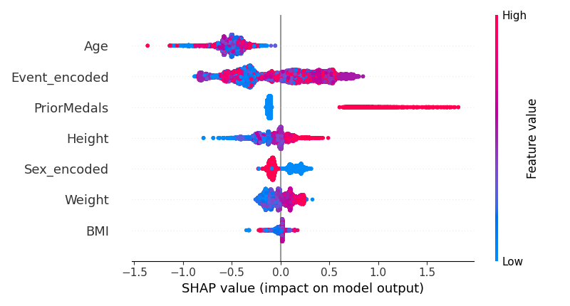
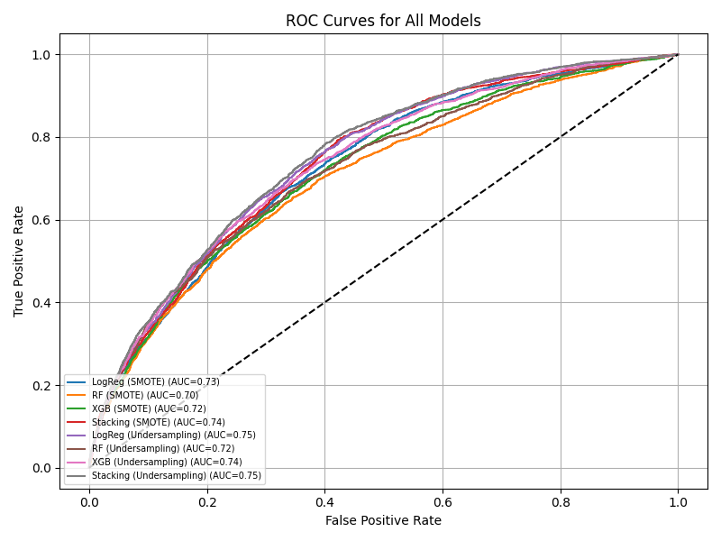
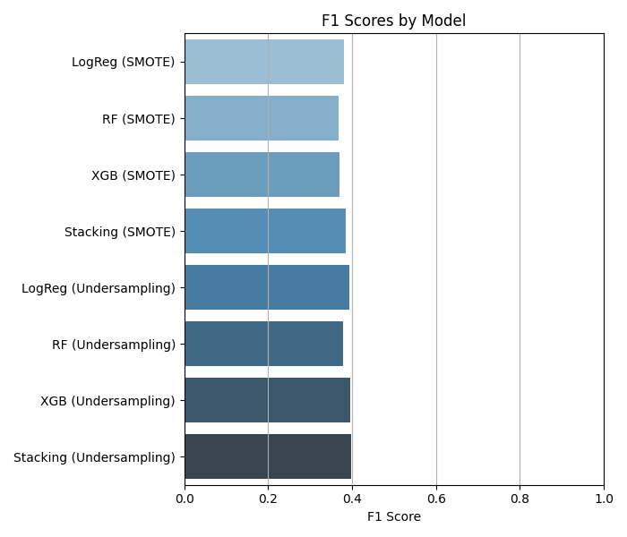

# Olympic Medal Prediction

**Can an athlete's age, size, event and past results predict an Olympic medal?** A machine-learning project built on 271,116 athlete entries from every Olympic Games from 1896 to 2016.

I built it to practise the full data-science workflow from start to finish: cleaning data, building features, handling a rare outcome, tuning, comparing models and explaining them. Every model is trained on the Games up to 2014 and tested on Rio 2016, which it never saw.



## Key findings

- **Past success is the strongest signal.** At Rio 2016, entries from athletes with no earlier Olympic medal won 12% of the time, against 37% for one or two earlier medals and 48% for three or more.
- **The choice of algorithm barely matters.** All eight combinations of model and resampling method score between 0.37 and 0.40 F1. A plain logistic regression comes within 0.01 of the stacked ensemble.
- **Accuracy is the wrong scoreboard here.** Only 15% of entries win a medal, so always guessing "no medal" scores 85% accuracy, higher than every model (70–74%).
- **Most medals are team medals.** About 2 in 3 medal entries at Rio 2016 came from team events, where every team member counts as a medal entry.

## What it practises

- **Honest evaluation.** The models are trained on 1896–2014 and tested on all 13,443 entries from Rio 2016. The best model reaches ROC AUC 0.75, against 0.5 for a coin flip. When it predicts a medal it's right 29% of the time, about twice the 15% base rate, and it finds 63% of medallists.
- **Handling a rare outcome.** It compares SMOTE oversampling with undersampling. Both run only inside training folds, so no synthetic data reaches validation or test.
- **Four algorithms, tuned and compared.** Logistic regression, random forest, XGBoost and a stacked ensemble, each tuned with randomized search and given a decision cutoff picked on held-out data. SHAP then shows what drives the XGBoost model.
- **Improved after finding flaws in my own work.** The first version tuned its models on the test year, let SMOTE create impossible athletes (such as women in men's events) and tested only on first-time Olympians. After fixing these and adding past medals as a feature, the best F1 rose from 0.31 to 0.40, on a test set that now includes every 2016 athlete. See [Version history](docs/technical.md#version-history).

**Tech stack:** Python, pandas, scikit-learn, imbalanced-learn, XGBoost, SHAP, matplotlib, seaborn.

## Results

<p>
  
  
</p>

Every model beats the coin-flip line by a similar margin. The full table with precision, recall and PR AUC is in the [technical details](docs/technical.md#evaluation).

## Run it

Python 3.12.

```bash
pip install -r requirements.txt
python main.py
```

It takes about 6 minutes, prints the results table and saves all six figures to `figures/`. The tuned settings are included, so you don't need to retune. To retune, see [docs/technical.md](docs/technical.md#running-and-retraining).

## Data

[120 years of Olympic history: athletes and results](https://www.kaggle.com/datasets/heesoo37/120-years-of-olympic-history-athletes-and-results) by rgriffin on Kaggle: 271,116 entries from 135,571 athletes across 51 Games (1896–2016). Public domain ([CC0](https://creativecommons.org/publicdomain/zero/1.0/)).

## Limitations

- **No country information**: national team strength isn't used.
- **Team medals**: each team member counts as a separate medal entry.
- **Missing measurements**: 24% of entries are dropped, mostly from before 1960.
- **One test Games**: results come from Rio 2016 only, a Summer Games, while training also includes Winter Games.

**Next steps** that would improve it: country strength from earlier Games, the number of Games each athlete has entered, and testing on several Games in turn rather than one.

Method, full results, data cleaning, project layout and version history: [docs/technical.md](docs/technical.md)
